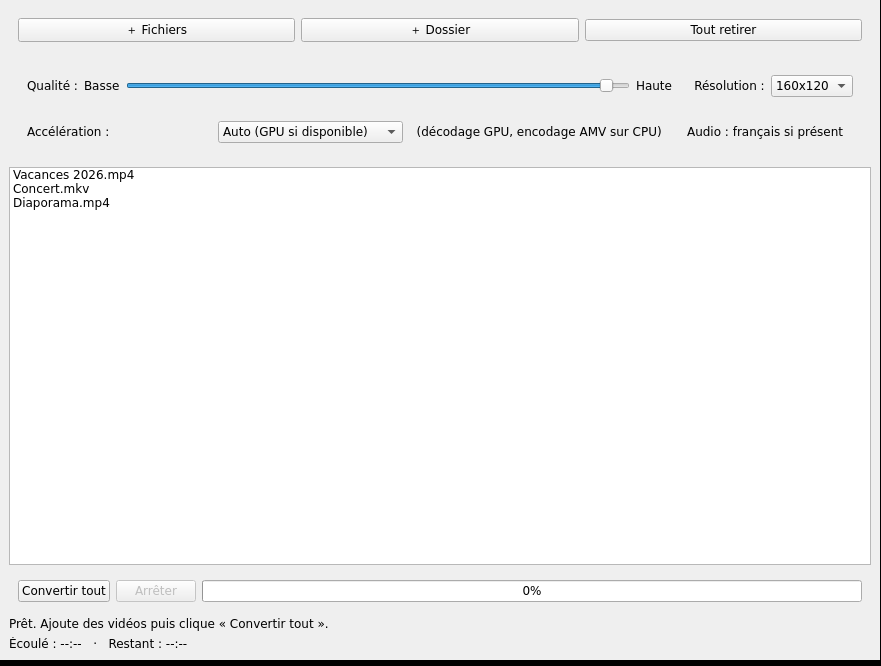

# AMV Converter

Convertisseur graphique (Qt6) de vidéos vers le format **AMV** pour petits lecteurs MP3/vidéo (160×120, 128×96, 176×144, 160×128).



## Installation

### Via le dépôt eopkg (Solus)

```bash
sudo eopkg add-repo linuxon https://raw.githubusercontent.com/Julien684/eopkg-repo/main/eopkg-index.xml
sudo eopkg install -y amv-converter
```

### Via le paquet direct

```bash
sudo eopkg install -y https://github.com/Julien684/amv-converter/releases/download/v0.2.0/amv-converter-0.2.0-3-1-x86_64.eopkg
```

## Prérequis

- `ffmpeg` et `ffprobe` dans le PATH (`sudo eopkg install ffmpeg` sur Solus)
- Optionnel pour l'accélération GPU : un pilote VAAPI (Intel/AMD), NVDEC (NVIDIA) ou QSV (Intel)

## Utilisation

Lancez `amv-converter` (menu d'applications ou terminal). Ajoutez des fichiers ou un dossier — ou passez-les directement en argument — réglez la qualité, la résolution et l'accélération, puis cliquez « Convertir tout ».

Pendant la conversion, la barre de progression indique l'avancement du fichier en cours et la ligne du dessous affiche le temps écoulé et le temps restant. Le bouton « Arrêter » interrompt réellement le ffmpeg en cours.

L'audio français est sélectionné automatiquement s'il est présent dans la source. Une vidéo sans piste audio est convertie avec une piste silencieuse (le format AMV exige deux flux).

## Accélération matérielle

Le menu « Accélération » propose **Auto**, **CPU** et les décodeurs détectés au lancement :

| Choix | Décodage |
|---|---|
| Auto (GPU si disponible) | premier décodeur matériel trouvé, sinon CPU |
| CPU (logiciel) | tout sur le processeur |
| GPU — VAAPI (Intel/AMD) | `-hwaccel vaapi -hwaccel_device /dev/dri/renderD128` |
| GPU — NVDEC (NVIDIA) | `-hwaccel cuda` |
| GPU — QSV (Intel) | `-hwaccel qsv` |

Seul le **décodage** est déporté sur le GPU : le codec AMV n'a pas d'encodeur matériel, l'encodage reste sur le CPU. Si le décodeur choisi échoue (pilote absent, profil non supporté), le fichier est automatiquement reconverti en CPU et le repli est signalé dans la barre d'état.

```bash
amv-converter --list-gpu        # décodeurs matériels détectés
```

## Mode batch (sans interface)

Pratique pour des scripts ou des tests ; l'interface n'est pas lancée.

```bash
amv-converter --batch --gpu cpu --quality 2 --size 160x120 *.mkv
```

Sortie lisible par machine : `ACCEL`, `FILE`, `AUDIO`, `PROGRESS pct=… elapsed=… remaining=…`, `OK`/`FAIL`, `DONE ok=… fail=…`. Code de sortie 0 si tout réussit, 1 si un fichier échoue, 2 sur option invalide.

## Format AMV

Le format AMV est un hybride RIFF/`AMV `/`AVI ` utilisé par les petits lecteurs MP3/vidéo bon marché. ffmpeg encode nativement les codecs `amv` (vidéo) et `adpcm_ima_amv` (audio).

Paramètres fixes :
- Vidéo : `-c:v amv -q:v <1-31> -strict -1` (strict -1 car la hauteur n'est pas un multiple de 16)
- Audio : `-c:a adpcm_ima_amv -block_size 735 -ar 22050 -ac 1`
- Résolution : letterbox automatique (`force_original_aspect_ratio=decrease` + `pad`)
- FPS : 30
- Progression : `-progress pipe:1 -stats_period 0.2`

## Tests

```bash
cargo test --release              # tests unitaires (sans affichage)
bash tests/nonregression.sh       # tests de non-régression (ffmpeg requis)
BIN=/usr/bin/amv-converter bash tests/nonregression.sh   # paquet installé
```

Les tests de non-régression couvrent la progression (au moins deux mesures, croissantes, temps restant décroissant), la conformité de la sortie AMV, la sélection de la piste française, le nommage unique, la résolution demandée, la source sans audio, le repli GPU → CPU, les entrées invalides et le démarrage de l'interface en mode `offscreen`.

## Dépendances runtime

Aucune dépendance eopkg déclarée (ffmpeg/ffprobe vérifiés au lancement).

## Licence

GPL-3.0-or-later
